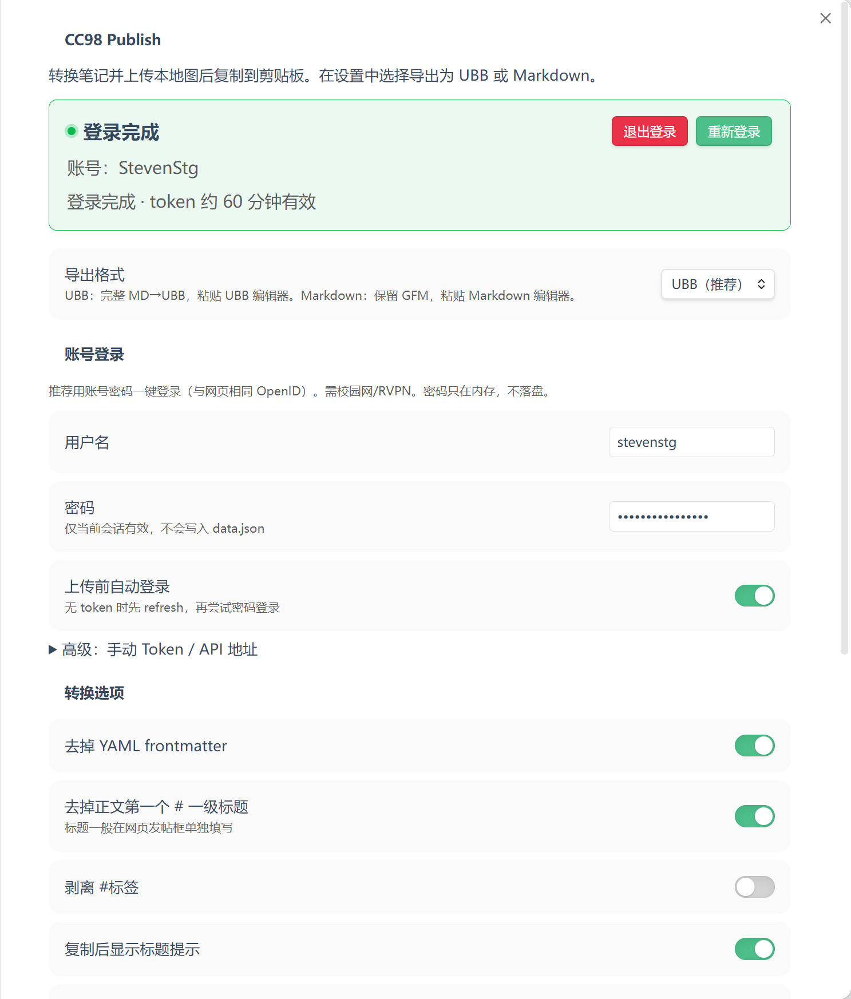
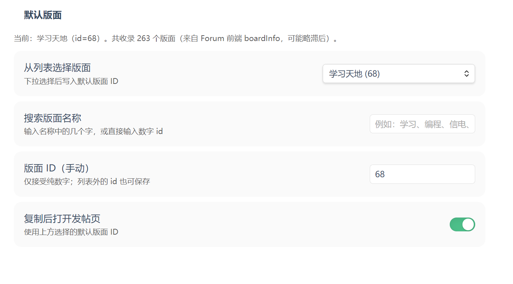

# CC98 Publish

Obsidian 插件：把当前笔记转成可粘贴到 [CC98 论坛](https://www.cc98.org) 的正文，可选上传本地图片，并按设置导出为 **UBB** 或 **Markdown**。

> **不会自动发帖。** 插件只负责转换、上传图片、复制到剪贴板；版面、标题和最终提交仍在网页端完成。

**要求：** Obsidian ≥ 1.5.0  
**非官方项目**，与 CC98 / 浙江大学无隶属关系。

---

## 功能

- 清理 YAML frontmatter、wikilink、callout、高亮等 Obsidian 语法
- 导出格式二选一（**仅设置切换，无额外「复制为 xxx」命令**）：
  - **UBB（默认）**：完整 Markdown → UBB，适合论坛 UBB 编辑器
  - **Markdown**：保留常见 Markdown，图片为 ``，适合论坛 Markdown 编辑器
- 本地图片（`![[…]]` / ``）可上传到 `file.cc98.org` 并改写为图床链接
- 账号登录获取 token（OpenID password grant）；密码只存当前会话，默认不写磁盘
- 版面下拉选择 / 名称搜索 / 纯数字 ID
- 侧边栏按钮 + 命令面板

## 界面预览





---

## 安装

### 方式 A：从 GitHub Release 安装（推荐普通用户）

1. 打开本仓库的 **Releases** 页面，下载最新版压缩包（或分别下载下面三个文件）
2. 在 vault 中创建目录：

   ```text
   <你的库>/.obsidian/plugins/obsidian-cc98-publish/
   ```

3. 将以下文件放入该目录：

   | 文件 | 说明 |
   |------|------|
   | `main.js` | 插件主程序 |
   | `manifest.json` | 插件清单 |
   | `styles.css` | 设置页样式 |

4. 打开 Obsidian → **设置 → 第三方插件**
   - 关闭「安全模式」（若尚未关闭）
   - 启用 **CC98 Publish**
5. 如未出现，执行一次 **重新加载应用**（或重启 Obsidian）

> 只需上述三个文件即可使用，**不需要**安装 Node.js，也**不要**把 `node_modules` 拷进插件目录。

### 方式 B：用 BRAT 安装（可选）

若已安装 [BRAT](https://github.com/TfTHacker/obsidian42-brat)：

1. BRAT → *Add beta plugin*
2. 填入本仓库地址
3. 启用 **CC98 Publish**

### 方式 C：从源码构建（开发者 / 贡献者）

```bash
git clone https://github.com/stevenstg/obsidian-cc98-publish.git
cd obsidian-cc98-publish
npm install
npm run build
```

将生成的 `main.js`、`manifest.json`、`styles.css` 放到  
`<vault>/.obsidian/plugins/obsidian-cc98-publish/`，然后在 Obsidian 中启用插件。

开发时可用：

```bash
npm run dev    # watch 构建
npm test       # 单元测试
npm run build  # 生产构建
```

---

## 快速开始

1. **设置 → CC98 Publish**
   - 选择 **导出格式**（UBB 或 Markdown）
   - （可选）选择默认版面
2. **登录（上传图片时需要）**
   - 填写 CC98 用户名
   - 填写密码（仅当前 Obsidian 会话有效，**不会写入 `data.json`**）
   - 点击 **登录**；状态卡显示「登录完成」即表示 token 已验证
3. 打开一篇 `.md` 笔记
4. 任选其一：
   - 左侧功能区 **剪贴板** 图标
   - 命令面板 → **CC98: Copy current note for paste**
   - 选中文本后 → **CC98: Copy selection for paste**
5. 浏览器打开 CC98 发帖页 → 按设置粘贴到 **UBB** 或 **Markdown** 编辑器 → 填标题 → 发帖

### 命令一览

| 命令 | 作用 |
|------|------|
| CC98: Copy current note for paste | 转换当前笔记；有本地图则上传；复制结果 |
| CC98: Copy selection for paste | 同上，仅处理选区 |
| CC98: Login (fetch token) | 用用户名密码获取 / 刷新 token |
| CC98: Test API connectivity | 探测 `api.cc98.org` 是否可达 |

---

## 网络要求

上传图片与登录依赖：

- `openid.cc98.org`（鉴权）
- `api.cc98.org`（上传等）
- `file.cc98.org`（图床）

这些接口通常需要 **校园网** 或 **浙大 RVPN**。

**浏览器能打开 98，不代表 Obsidian 一定能上传。**  
若使用 Clash / v2rayN 等代理，请对以下域名设为 **DIRECT（直连）**：

- `cc98.org`、`*.cc98.org`
- `api.cc98.org`、`openid.cc98.org`、`file.cc98.org`

不确定时先运行 **CC98: Test API connectivity**：

- 通 → 再复制笔记并上传  
- 不通 → 先修网络 / 代理；或暂时不依赖上传，只复制无本地图 / 已是外链图的正文  

---

## 账号与安全

| 项 | 行为 |
|----|------|
| 密码 | 只在当前会话内存；**从不**写入 `data.json` |
| Access / Refresh Token | 优先写入系统密钥库（`secretStorage`，若可用） |
| 持久化 Refresh Token | **默认关闭**；OneDrive / iCloud 等同步库强烈建议保持关闭 |
| 关闭持久化时 | refresh 仅会话内使用，不会写进 vault 同步文件 |

建议：

- 不要把 token / 密码截图发到公开场合  
- vault 若在云同步盘，务必确认「持久化 Refresh Token」为关  
- 退出登录可清除会话与密钥库中的 token  

鉴权流程（上传前 / 401 时）：

1. 使用已有 access token  
2. 失败则 refresh  
3. 仍失败且开启「上传前自动登录」则用密码重新登录  
4. 同一轮上传中鉴权恢复后，当前图片只重试一次  

使用的是与网页前端相同的公开 OpenID client（`grant_type=password`），请求发往 `https://openid.cc98.org/connect/token`。

也可在浏览器登录后，从开发者工具手动复制 `access_token` / `refresh_token` 填入设置（高级用途）。

---

## 设置项摘要

| 设置 | 默认 | 说明 |
|------|------|------|
| 导出格式 | UBB | 或 Markdown |
| 用户名 / 密码 | — | 密码仅会话 |
| 上传前自动登录 | 开 | 无有效 token 时 refresh → 密码登录 |
| 持久化 Refresh Token | 关 | 同步盘建议关 |
| 去掉 frontmatter | 开 | |
| 去掉正文第一个 `#` 标题 | 开 | 标题一般在网页发帖框填写 |
| 默认版面 | — | 下拉 / 搜索 / 纯数字 ID |
| 复制后打开发帖页 | 关 | 使用默认版面 ID |
| 长度警告 | 8000 | 超过字数时提示（不阻止复制） |

---

## 转换说明

### 通用（UBB / Markdown 都做）

| 输入 | 输出 |
|------|------|
| YAML frontmatter | 去掉 |
| 第一个 `# 标题` | 默认去掉（可关） |
| `[[笔记\|显示名]]` | `显示名` |
| `![[图.png]]` 上传成功 | 图床 URL（语法随导出格式） |
| Callout | 引用 + 粗体标签 |
| `==高亮==` | 粗体（代码块内不转换） |
| 代码块 / 行内代码 | **不**做强调、高亮等改写；代码内本地图**不上传** |
| PDF / 视频 / zip 等 | 不上传、不改成图片标签 |
| 表格、列表、外链图 | 保留 |

### UBB 映射（导出格式 = UBB）

| Markdown / HTML | UBB |
|-----------------|-----|
| `#` … `######` | `[size=7]` … `[size=2]` |
| `**粗**` / `__粗__` / `<b>` `<strong>` | `[b]` |
| `*斜*` / `_斜_` / `<i>` `<em>` | `[i]` |
| `~~删~~` / `<del>` `<s>` | `[del]` |
| `<u>` / `++下划++` | `[u]` |
| `***粗斜***` | `[b][i]…[/i][/b]` |
| `<div align="center">` 等 | `[align=…]` |
| `[文](url)` | `[url=url]文[/url]` |
| `` | `[img]url[/img]` |
| bilibili / `.mp4` / `.mp3` 直链 | `[bili]` / `[video]` / `[audio]` |
| `` `代码` `` | `"代码"`（双引号包裹） |
| fenced / 缩进代码块 | `----------` … `-----------` |

导出为 **Markdown** 时不做上表转换，图片为 ``。

---

## 限制与已知问题

- **不**自动在论坛发主题或跟帖  
- Excalidraw / 画板等请先导出为 PNG/JPG 再嵌入笔记  
- 上传超时后界面可能已提示结束，底层请求在个别环境下仍可能继续（Obsidian `requestUrl` 无法硬取消）  
- 版面列表来自 Forum 前端的静态快照，可能略滞后；列表外版面可用纯数字 ID 手动填写  
- 超长帖（默认提示 8000 字）需自行拆楼  
- 未上架 Obsidian 官方社区插件市场时，只能通过 Release / BRAT / 源码安装  

---

## 反馈

- Bug、功能建议：请在本仓库开 **Issue**  
- 贡献代码：欢迎 PR；改动前请先 `npm test` 与 `npm run build`  

---

## 许可证

[MIT](LICENSE)
